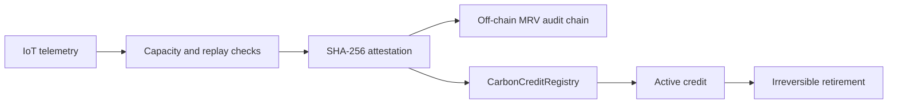

# CarbonGuard

CarbonGuard is a prototype MRV (measurement, reporting, and verification) gateway
for the IEEE ClimateChain Global Hackathon. It validates bounded renewable-energy
telemetry, produces deterministic carbon-accounting records, and anchors credit
lifecycle invariants in a Solidity registry.

## What is implemented

### Off-chain MRV gateway

- Scope 1, Scope 2, and Scope 3 calculation examples using an explicit factor table.
- Registered-sensor checks, physical capacity bounds, and monotonic timestamps.
- SHA-256 attestations for accepted telemetry.
- A tamper-evident SHA-256 audit chain.
- An in-memory reference lifecycle used to demonstrate mint and retirement flows.

The calculation examples are methodology-aligned prototypes, not certified carbon
accounting. The bundled factors are disclosed in `src/ghg_calculator.mjs`; they must
be replaced with jurisdiction-, year-, and activity-specific factors before real
reporting.

### On-chain registry

`contracts/CarbonCreditRegistry.sol` is a real Solidity enforcement layer. It:

- permits minting only from the configured MRV oracle;
- prevents the same attestation hash from minting twice;
- records owner, CO2e quantity, metadata hash, and issue timestamp;
- permits retirement only by the credit owner; and
- makes retirement irreversible.

The contract is compiled with `solc` and executed in a real local EVM during tests.
It is not deployed to a public chain, and this prototype does not claim a production
token, live sensor fleet, or certified registry integration.

## Architecture



## Run it

Requires Node.js 20 or newer.

```bash
npm install
npm test
npm run demo
npm run demo:onchain
```

`npm test` compiles the Solidity contract and runs both the MRV suite and the
local-EVM contract suite. Current verified result: 18/18 tests passing.

## Demo video

The repository includes a 4-minute 18-second narrated, captioned walkthrough:

- [Watch on YouTube](https://youtu.be/1-yY4xgVH3U)
- [`demo/CarbonGuard_IEEE_ClimateChain_Demo.mp4`](demo/CarbonGuard_IEEE_ClimateChain_Demo.mp4)

With FFmpeg built with the `flite` and `libass` filters, reproduce it with:

```bash
npm run demo:video
```

The video covers the threat model, off-chain telemetry rejection, Solidity
invariants, actual local-EVM output, test evidence, and the prototype limits.

## Tested invariants

- Invalid emissions inputs fail closed.
- Unregistered, over-capacity, and replayed telemetry is rejected.
- A verified attestation produces a deterministic hash.
- A used attestation cannot mint another on-chain credit.
- A non-oracle address cannot mint.
- A non-owner cannot retire a credit.
- A retired credit cannot be retired again.
- The off-chain audit chain detects mutation.

## Limits

- No public-chain deployment or production custody.
- No ERC-20, ERC-721, ERC-1155, or registry interoperability claim.
- Sensor identity is registered locally; hardware signatures are future work.
- Factor governance, versioning, and third-party verification are future work.
- This code is a hackathon prototype, not a certified offset issuance system.

## Submission

- Competition: IEEE ClimateChain Global Hackathon 2026
- Track: Carbon Markets and Emissions Transparency
- Author: Siddharth Srivastava (`sidsri14`)
- License: MIT
